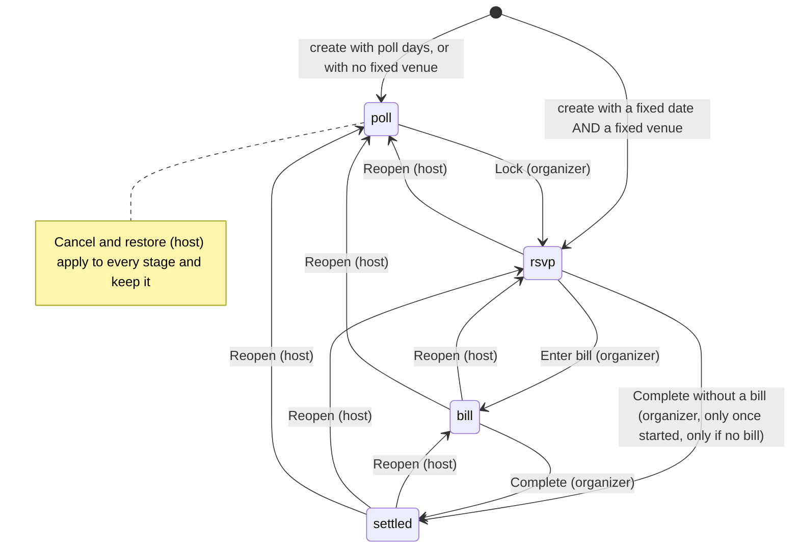

# 2. Event lifecycle

An event has one **stage**, stored in `events.stage` and checked by a DB constraint: `poll`, `rsvp`, `bill`, `settled`.
**Cancelled** is separate: an overlay (`events.cancelledAt`) that can sit on any stage.
Every stage change goes through one handler, `PATCH /api/events/:id` (`server/api/events/[id].patch.ts`).

## How an event is born (`POST /api/events`)

Requires a signed-in member (the creator becomes **host**) and either poll days or a fixed date. The response contains the new
`id` and the **manage key** (shown once; the browser stores it).

| What the creator chose | Stored | Starting stage |
|---|---|---|
| Poll days (1 to 20) | `pollDays`, `startsAt = null` | `poll` |
| Fixed date, fixed venue | `startsAt`, `venue` | `rsvp` |
| Fixed date, "let people suggest places" (no venue) | `startsAt`, no venue | `poll` (places are voted; days are not) |
| Poll days + fixed venue | `pollDays`, `venue` | `poll` |

Rule in code: `stage = pollDays.length || !venue ? 'poll' : 'rsvp'`. A fixed date must lie ahead (`startsInPast` otherwise); a few minutes ahead is enough.

## Transition table

"Organizer" = host or co-host (`can(role, 'advance')`). "Host" = host only. See [03](03-identity-and-roles.md) for roles.

| Move | Who | Request body (essentials) | Preconditions | Side effects on people |
|---|---|---|---|---|
| **Lock**: `poll → rsvp` | Organizer | `stage:'rsvp'`, plus `startsAt` (day polls) and/or `venue` (place polls) | Event must end up with a `startsAt`, and it must lie ahead (`startsInPast`) | Members with votes that fit the plan and no answer become `going` (derived). See [04](04-polling-and-locking.md). Votes are kept. |
| **Enter bill**: `rsvp → bill` | Organizer | `stage:'bill'`, `billTotal`, optional bank fields | Event has started (`notStarted` otherwise) | Pending holds are released. |
| **Complete, no bill**: `rsvp → settled` | Organizer | `stage:'settled'` (no `billTotal`) | Event has started (`notStarted` otherwise) and has no bill | Pending holds are released. The only allowed skip of a stage. |
| **Complete**: `bill → settled` | Organizer | `stage:'settled'` | None on the server. The UI asks for confirmation when someone still owes. | None. People who owe may still report payments. |
| **Reopen to an earlier stage** | **Host** | `stage:<earlier>` | Not cancelled | See below. |
| **Close voting** | Organizer | `closeVoting:true` | Stage is `poll` | Sets `voteDeadline = now` (never moves an earlier close time). |
| **Reopen voting** (inside `poll`) | Organizer | `reopenVoting:true`, `voteDeadline` (future time or `null`) | Stage is `poll` | None. Votes are never touched. |
| **Cancel** | Host | `cancel:'<reason ≤ 200 chars>'` | none | None. Everything becomes read-only. |
| **Restore** | Host | `restore:true` | none | None. Returns to the exact stage. |
| **Delete** | Host | `DELETE /api/events/:id` | none | Cascades to responses, venues, co-hosts. |

Forward moves go **one stage at a time**. The single skip is `rsvp → settled` above. Anything else returns `stageClosed`.

### Reopening

Only the host may go backwards, and to any earlier stage.

- **To `poll`**: unpaid *derived* answers (counted-from-votes and held seats) and all holds are cleared; explicit answers, votes and payments stay. If any payment is recorded the host must send `acknowledgePayments:true` (`hasPayments` otherwise). The request must carry `reopenVoting:true` and a `voteDeadline` (future time or `null`). For a day poll the locked `startsAt` is cleared (the venue stays).
- **To `rsvp` or `bill`**: a plain stage change. No attendance or payment rows are rewritten.
- Reopening is not offered on a cancelled event.

### Cancelled overlay

While `cancelledAt` is set, nearly every write fails with `cancelled` (409): stage moves, edits, votes, RSVPs, payments, suggestions,
co-host invites. Only **restore** (and delete) work. The home page files a cancelled event under "Past".

## Voting window (stage `poll` only)

`votingOpen(ev)` = stage is `poll`, not cancelled, and (no `voteDeadline` or now is before it).

- Participants can only write votes while it is open (`votingClosed` otherwise).
- Organizers can still vote and edit anyone's votes after the deadline.
- A `poll` past its deadline is labelled "waiting for the date" (`stageKey` → `pollClosed`) but is still stage `poll`; only Lock advances it.
- Editing the deadline of a closed poll is refused (`votingClosed`); to reopen on purpose use **Reopen voting**.

## The plan freezes

`planFrozen(ev)` is true when the stage is `bill` or `settled`, or the stage is `rsvp` and `startsAt` has passed.
While frozen, `startsAt`, `venue` and `venueLink` cannot be edited (`planFrozen`). To fix a mistake use a **correction**:
`PATCH { correct:true, startsAt?/venue?/venueLink?, notice }`, which requires a notice, writes only those fields (and `noticeAt`),
and never touches attendance, holds or payments. In `rsvp`, a corrected `startsAt` must stay in the past.

## Editing an event (non-frozen fields)

`PATCH` with any of `title`, `note`, `capacity`, `cover`, `theme`, `honorees`, bank fields, `notice`, `voteDeadline`, and (before the plan freezes) date and place.

- **Capacity** has no side effects on rows: the queue is recomputed on read, so lowering it pushes the last confirmed parties onto the waitlist and raising it promotes the first waiting parties. The edit panel previews this with `capacityImpact`.
- **Days** (stage `poll`): `addDays` / `removeDays` are diffs applied to the live list so a day suggested meanwhile survives; votes for removed days are pruned in the same batch. At least 1 and at most 20 days (`daysRequired`, `tooManyDays`). A diff cannot be combined with a stage move or a plan change.
- **A new `startsAt`** must lie ahead (`startsInPast`), in `poll` and in `rsvp`. Only a correction (above) may set a past time.
- **Moving date or place in `rsvp`** creates holds. See [04](04-polling-and-locking.md#plan-changes-after-the-lock).
- **Notice**: setting a different notice stamps `noticeAt`; clearing removes both. Clients show a "new" dot until they have seen that version.

## What each visitor is told to do next

The "next step" card and the home page's "needs you" list both use `nextStep()` in `shared/utils/event.ts`.

| Stage | Visitor step | Meaning |
|---|---|---|
| `poll` | `vote` / `voted` / `declined` / `voteClosed` | Pick days, already voted, said "can't join", voting closed |
| `rsvp` | `rsvp` / `confirm` / `going` / `waitlist` / `replied` / `done` | Answer now; confirm (voted, or seat held); has a seat; waiting; answered maybe/no; started |
| `bill` | `pay` / `paid` | Owes money; paid in full |
| `settled` | `pay` / `settled` | Still owes (can pay after Completed); done |
| any, cancelled | `cancelled` | Nothing to do |

The **organizer's action** is separate: `lock` in `poll`; `bill` in `rsvp` once started; `settle` in `bill` once everyone has paid.
Before the start, organizers see when the bill opens ("You can enter the bill once the event starts").
The stage badge (`stageKey`) of a started `rsvp` event reads "Awaiting the bill" (`awaitingBill`) instead of "Confirmed"; the stage is still `rsvp`.
To-do kinds shown on the home page: `vote`, `rsvp`, `confirm`, `pay` (visitor) and `lock`, `bill`, `settle` (organizer).

## Where events appear on the home page

`bucketOf` in `app/pages/index.vue`: cancelled → **Past**; stage `poll` → **Planning**; `settled`, or started more than 6 hours ago → **Past**; otherwise **Upcoming**.
