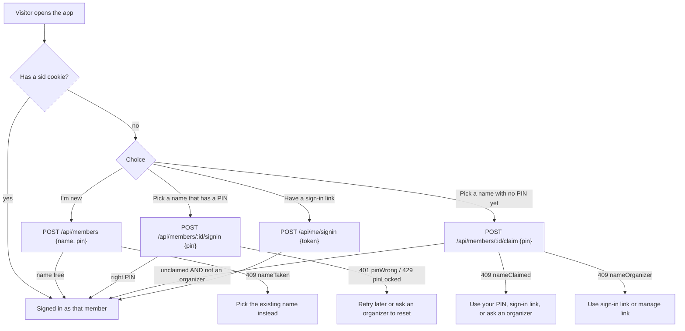

# 3. Identity and roles

There are **no passwords**, but each name has a **6-digit PIN**. Identity is "who this browser is signed in as", and event power is "which key this request carries".
Two independent mechanisms exist and are combined in `roleOf`.

## 3.1 Who am I? (member session)

| Concept | Detail |
|---|---|
| Token | A random 32-byte value (`base64url`). Only its SHA-256 is stored (`members.tokenHash`, unique). |
| Cookie | `sid`, `httpOnly`, `sameSite=lax`, `secure` outside dev, max-age 400 days. |
| Lookup | `meOf(event)` resolves the cookie to a member id once per request (cached in `event.context.me`). A token matches `members.tokenHash` (the first browser) or a `member_sessions` row (a browser signed in with the PIN). |
| PIN | Exactly 6 digits, not all alike and not a run like 123456 (`pinProblem` in `shared/utils/pin.ts`). Stored as `salt:hash` (scrypt, `members.pinHash`). Pick your name and enter the PIN to sign in on any device; no link needed. |
| Lockout | Each PIN guess is counted in one atomic UPDATE *before* it is checked (`members/:id/signin`), so parallel guesses cannot slip past. After 5 wrong PINs the name is locked for 15 minutes (`pinLocked`). A wrong PIN, an unknown name and a name without a PIN all answer `pinWrong`. |
| Sign-in link | `/#signin=<token>`. The page posts the token to `/api/me/signin`, which sets the cookie. The token **is** the cookie value, so the link works like a password. Kept so old links keep working; the PIN is the everyday way in. |
| Sign-out | `POST /api/me/signout` clears this browser's cookie. The page then forgets every manage and co-host key stored on this device (`te:keys`, `forgetAllManageKeys`), and the confirm text says so. The token stays valid; the sign-in link still works, and so does the PIN. A host gets access back by signing in (the creator is host) or by opening the manage link again. |

### Ways to become a member



- **I'm new** (`POST /api/members`): takes the name and a PIN. Trims and collapses whitespace in the name (max 50). The name is unique as an exact string; a 409 `nameTaken` means someone has it. The one exception is an archived name that was never claimed and created no event: adding it again reuses that member (signs in as it and un-archives it). The UI also asks "Is that you?" when a *similar* name exists (`norm()` ignores case and diacritics: Thien / Thiên / THIEN).
- **Claim** (`POST /api/members/:id/claim {pin}`): for names added before sign-in existed (no token and no PIN yet); the claimer chooses the PIN. One conditional UPDATE lets only the first claimer win. A name that **created an event** can never be claimed, because claiming would hand over host rights (`nameOrganizer`).
- **Move to another device**: pick your name and enter your PIN there. The older way still works: `POST /api/me/link` returns the current token (requires being signed in); open `/#signin=<token>` elsewhere.
- **Set or change a PIN** (`POST /api/me/pin {pin}`, signed in): the session is the proof, so there is no "old PIN". Members who signed in before PINs existed see a nudge in the account menu. A name that is claimed but has no PIN is not in the name list; it needs its sign-in link, or an organizer's reset.
- **Reset a PIN** (`POST /api/members/:id/pin-reset`, signed in as someone who has created an event): returns a random new PIN, shown once to pass on privately. It also signs the member out everywhere (their sessions and old sign-in link stop working). Refused for a member who has created an event (`pinResetOrganizer`): it would hand their hosting rights to another organizer; they sign in with their own PIN or sign-in link.
- `GET /api/members` lists the roster (archived members left out) with `claimed` (token or PIN set, or creator of an event) and `hasPin`. `GET /api/me` returns the current member with `organizer` (has created an event) and `hasPin`, or `null`.

### Archived members

Members are team-wide and never deleted. To hide leftover or test names, anyone who has **created at least one event** may archive any member
(`POST /api/members/:id/archive`, sets `members.archivedAt`; from "Tidy the team list" in the sidebar account menu).

- An archived member drops out of `GET /api/members`, so out of the name list, the roster avatars and every "no reply yet" count.
- Their responses, votes and payments stay. Nothing else changes.
- They come back when they sign in with their PIN or sign-in link (`/api/me/signin`, `/api/members/:id/signin` and a claim from the name list all clear `archivedAt`), or, if the name was never claimed, when someone adds the same name again (see **I'm new**). A browser still signed in by cookie stays hidden until then.

## 3.2 What may I do on this event? (role)

```
role = host     if   x-manage-key matches events.manageKeyHash
              or   signed-in member is events.createdBy
     = cohost   if   x-manage-key matches events.coHostKeyHash         (legacy shared co-host key)
              or   an ACTIVE cohosts row matches the key (keyHash) or the signed-in member
     = null     otherwise (participant)
```

(`roleOf` in `server/utils/http.ts`; the order above is the evaluation order.)

Keys are random 32-byte `base64url` strings; only SHA-256 hashes are stored; comparison uses `timingSafeEqual`.
The browser keeps manage keys in `localStorage` under `te:keys` (`{ [eventId]: key }`) and `useEventApi` sends the stored key as
`x-manage-key` on every call. A `?key=` URL parameter is stored then stripped; when two keys exist the higher-ranked one wins.
If the server stops accepting a key (revoked, rotated), the page forgets it.

### Permission table (`shared/utils/roles.ts`)

| Action | Co-host | Host | Used for |
|---|---|---|---|
| `edit` | ✔ | ✔ | Edit panel, notices, corrections, adding/removing poll days |
| `advance` | ✔ | ✔ | Lock, enter bill, complete, close/reopen voting |
| `removeVenue` | ✔ | ✔ | Remove a suggested place |
| `setOthers` | ✔ | ✔ | Change another member's RSVP or payment from the People list |
| `reopen` | ✘ | ✔ | Move to an earlier stage |
| `cancel` | ✘ | ✔ | Cancel, restore |
| `delete` | ✘ | ✔ | Delete the event |
| `cohost` | ✘ | ✔ | Invite, re-issue, revoke co-hosts; manage the legacy key |

`can(role, action)`: host can do everything; co-host only actions whose minimum role is co-host; participant nothing.
**Always go through `can()` / `requireCan()`**, never compare roles ad hoc.

### What participants may write

Enforced in the API, not the UI:

| Write | Participant | Organizer |
|---|---|---|
| Own votes (`days`, `venueIds`) | Only while voting is open and stage is `poll` | Any time in `poll`, on anyone's row |
| Suggest a day / place | Same window | Same |
| Own RSVP status and guests | Stage `rsvp` (and "can't join" while polling) | Any stage, anyone's row |
| Own payment | Stage `bill`; `addPaid` also in `settled`; only with a seat ([06](06-bill-and-payments.md#63-recording-payments)) | Both stages, anyone's row, any amount |
| Another member's row | ✘ `notYou` (403) | ✔ |

`requireSelf` is the check: a participant may only write the row of the member their session cookie resolves to.

## 3.3 Named co-hosts (invite flow)

Up to **5** co-host rows per event, active plus pending (`MAX_COHOSTS`, `tooManyCohosts`). Invites last **7 days** (`INVITE_TTL_MS`).

```mermaid
sequenceDiagram
    participant H as Host
    participant S as Server
    participant I as Invitee
    H->>S: POST /cohosts {memberId}   (role: host)
    S-->>H: {invite}  (single-use secret, only its hash stored)
    H->>I: sends /e/:id#invite=<secret>
    I->>S: POST /cohosts/peek {invite}   (who is this for? valid / expired)
    I->>S: POST /cohosts/accept {invite} (must be signed in AS the invited member)
    S-->>I: {key}  (access key; invite burned in the same UPDATE)
    Note over I: key saved to localStorage; co-host on every device the member signs in on
    I->>S: POST /cohosts/decline {invite}  (alternative: removes the pending row)
```

- The `#invite=` fragment never reaches a server. The page moves it to `sessionStorage` and removes it from the address bar.
- Accepting swaps the row from `invited` (has `inviteHash`) to `active` (has `keyHash`); DB checks force exactly one of the two.
- The host can **re-issue** (`POST /cohosts {memberId, reissue:true}` cuts the old access) or **revoke** (`DELETE /cohosts/:memberId`). A co-host can **leave** (delete only the row their own key belongs to).
- Pending and expired invites are visible to organizers only; active co-hosts are public.
- A legacy shared co-host key (`POST/DELETE /cohost`, `events.coHostKeyHash`) still works until revoked but can no longer be created from the UI.

## 3.4 Security properties worth remembering

- A name is only as safe as its PIN and its sign-in link. Whoever knows the PIN or holds the token acts as that member. The roster is public, so the PIN is the only secret: six digits are kept safe by the lockout, the slow hash and the weak-PIN rules, which is enough for a team-internal app.
- Whoever holds an event's manage key is its host, **regardless of who is signed in**. Because the key sits in `localStorage`, anyone using that browser profile has host power on that event while the key is stored. Signing out forgets every key on that device (see 3.1).
- The create page only asks for a new name and never lists others, so it can't be used to browse the roster.
- **Everything is readable by anyone, by design**: all events, every member's votes, answers and payments, and the event's bank id, account number and holder. The app is team-internal; there is no per-event privacy.
