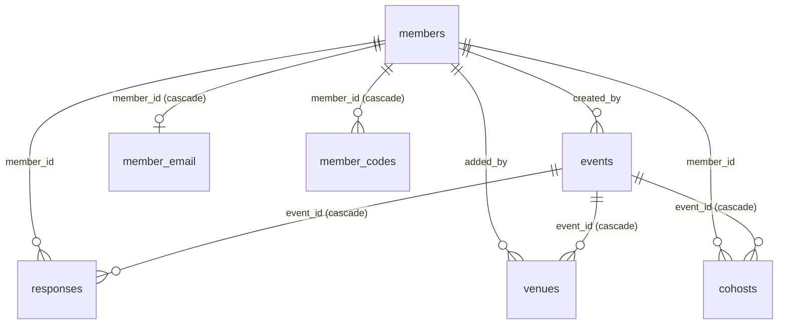

# 7. Data model

Postgres (Neon), accessed through Drizzle over the **HTTP driver**. Schema: `server/db/schema.ts`; migrations: `server/db/migrations/` (committed SQL + snapshot).
Column names are `snake_case` in the database and `camelCase` in code (`casing: 'snake_case'`).

Event deletion cascades to `responses`, `venues` and `cohosts`. Members are never deleted by the app; archiving (`archived_at`) hides them ([03](03-identity-and-roles.md#archived-members)). The API tests delete their own `zz-test-` members with SQL in `stopServer()`.

## `members`

| Column | Type | Notes |
|---|---|---|
| `id` | serial PK | |
| `name` | text, **unique**, not null | Exact-string unique; fuzzy matching (`norm`) is done in the UI |
| `token_hash` | text, unique | SHA-256 of the first browser's sign-in token (and the sign-in link); null = never signed in this way |
| `pin_hash` | text | `salt:hash` (hex, scrypt) of the 6-digit PIN; **token and PIN both null = unclaimed** |
| `pin_fails` | integer, default 0 | Wrong PINs since the last good one |
| `pin_locked_until` | timestamptz | Set when `pin_fails` reaches 5; sign-in is refused until then |
| `created_at` | timestamptz | |
| `archived_at` | timestamptz | null = on the roster; set = hidden from `GET /api/members`; cleared on sign-in or when the unclaimed name is added again |

## `member_sessions`

One row per extra browser signed in with a PIN: `token_hash` (PK, SHA-256 of the cookie token), `member_id` (FK to members, cascade), `created_at`. The first browser's token stays in `members.token_hash`. A PIN reset deletes the member's rows.

## `events`

| Column | Type | Notes |
|---|---|---|
| `id` | serial PK | |
| `title` | text not null | ≤ 100 chars (validated) |
| `note` | text not null, default `''` | ≤ 500; `@Name` shows as a chip |
| `stage` | text not null | check: `poll`, `rsvp`, `bill`, `settled` |
| `poll_days` | `date[]` not null, default `{}` | candidate days; empty for fixed-date events |
| `starts_at` | timestamptz | null while a day poll is unlocked |
| `venue`, `venue_link` | text | fixed place (or the locked place's name and link) |
| `capacity` | integer | null = unlimited; 1 to 500 (validated) |
| `planned_capacity` | integer | the limit before the attendance check raised it to fit everyone who came; null = never raised. The page shows `seats/planned + extra` while `capacity > planned_capacity` |
| `bill_total` | integer | VND; null = no bill |
| `bank_id`, `bank_account`, `bank_holder` | text | VietQR destination |
| `cover` | text | a preset key (`aurora`, `sunset`, `ocean`, `forest`, `candy`, `slate`) or an `https://` image URL; null = gradient chosen from `id % 6` |
| `max_guests` | integer | null = 10; check `between 0 and 10` (`events_max_guests`); see [05](05-rsvp-and-seats.md) |
| `hide_votes` | boolean not null, default false | the poll hides results from visitors who have not voted yet, see [04](04-polling-and-locking.md) |
| `honorees` | `integer[]` not null, default `{}` | member ids the event is for (max 20, validated; not a foreign key) |
| `theme` | text not null, default `aurora` | one of `aurora, ticket, liquid, bento, brutal, acid, scrapbook, candy` |
| `created_by` | integer FK → members, not null | the host by identity |
| `manage_key_hash` | text not null | SHA-256 of the host key |
| `repeat`, `repeat_until`, `series_id` | text (check `events_repeat`), date, integer | repeating events, see [04](04-polling-and-locking.md#48-repeating-events); `series_id` is the first event's own id (no foreign key), unique together with `starts_at` (`events_series_starts`) |
| `handover_to`, `handover_at` | integer FK → members (set null), timestamptz | pending offer to hand the event to a co-host, see [03](03-identity-and-roles.md#35-handing-an-event-over); both null when none |
| `co_host_key_hash` | text | legacy shared co-host key |
| `join_key` | text not null, default random 128-bit | secret in the joining link (`/e/:id?join=…`); stored readable so the link can be shared again |
| `vote_deadline` | timestamptz | null = voting stays open |
| `cancelled_at`, `cancel_reason` | timestamptz, text | the Cancelled overlay |
| `notice`, `notice_at` | text, timestamptz | the host's public announcement (≤ 280) |
| `reconfirm_by` | timestamptz | confirm-by deadline for held seats |
| `created_at` | timestamptz | |

## `venues` (suggested places)

`id`, `event_id` (FK, cascade), `name`, `link` (default `''`), `note` (default `''`), `added_by` (FK → members), `created_at`.
No unique constraint: duplicates are prevented in the API by comparing normalized names (a rare race can still insert two).

## `responses` (one row per member per event)

A row also means *participant*: the creator, active co-hosts and everyone who opened the joining link have one. An empty row (no days, no places, status null) is "no reply yet" and is inert in every bulk statement.

Primary key `(event_id, member_id)`. **Each person writes only their own row** (organizers excepted); this is the heart of the concurrency model.

| Column | Type | Notes |
|---|---|---|
| `days` | `date[]` not null, default `{}` | days the member can make |
| `venue_ids` | `integer[]` not null, default `{}` | upvoted places (not a foreign key; the API prunes removed places) |
| `maybe_days` | `date[]` not null, default `{}` | days the member could do "if need be"; kept apart from `days` (a day in both reads as yes). Pruned wherever `days` is |
| `maybe_venue_ids` | `integer[]` not null, default `{}` | places the member could do "if need be"; pruned wherever `venue_ids` is |
| `status` | text | `going`, `maybe`, `no`, or null |
| `guests` | integer not null, default 0 | check 0 to 10 |
| `going_at` | timestamptz | queue time |
| `paid_at` | timestamptz | set when any payment is recorded |
| `paid_amount` | integer | check ≥ 0; **null with `paid_at` set means paid in full** |
| `first_voted_at` | timestamptz | set once, on the first write of days or places |
| `derived` | text | `going` or `reconfirm`; null = the member's own answer |
| `no_show` | boolean not null, default false | had a seat but was unticked in the attendance check; cleared by any later status write |

Checks: `status in (...)`, `guests between 0 and 10`, `paid_amount >= 0`, `derived in (...)`, **`derived is null or status = 'going'`** and **`not no_show or status = 'no'`**.

## `member_email`, `member_codes`, `mail_log` (R4)

`member_email` (PK `member_id` to members, cascade): `email`, `verified_at`, `consent_at`, `consent_version`, `locale` (`vi` or `en`, language of mails), `muted_kinds` (text[]: the notification kinds the member switched off, see `notifications`), `prev_email`, `prev_until`, `recovery_after` (set together after a change: the cool-down, [13](13-email.md)). No unique index on `email`: two members may share an address. Never returned except to its owner.

`member_codes` (PK `(member_id, purpose)`, purpose `verify` or `recover`): `target_email`, `code_hash` (keyed HMAC, never the code), `expires_at`, `fails`, `sent_at`, `sends_today` and `sends_day` (the daily caps).

`mail_log` (`id`, `kind`, `sent_at`): one row per mail handed to the provider; the 24-hour budget is counted from it and rows older than two days are deleted.

## `notifications`, `notification_sends` (R5)

The outbox of event emails ([13](13-email.md#event-emails-the-outbox)).

`notifications`: `id`, `kind` (`planSet`, `paymentRequested`, `paymentRecorded`, `cancelled`, `tomorrow`, `paymentReminder`; check), `event_id` (cascade), `member_id` (null = everyone concerned; the payer for `paymentRecorded`), `fact` (what is announced, so the same news is queued once), `created_at`, `done_at`, `attempts`, `next_at` (not before; the 24 h wait of a mail over budget), `claimed_until` (a sender holds the row until then). Unique `(kind, event_id, coalesce(member_id, 0), fact)`; partial index on `next_at` where `done_at is null`.

`notification_sends` (PK `(notification_id, member_id)`, both cascade): one row per recipient, written before the mail goes out; `error` is set when the provider refused it. A row means "do not send again".

## `cohosts`

Primary key `(event_id, member_id)`.

| Column | Notes |
|---|---|
| `status` | `invited` or `active` |
| `invite_hash` | unique; SHA-256 of the single-use invite; present **iff** status is `invited` |
| `key_hash` | unique; SHA-256 of the access key; present **iff** status is `active` |
| `invited_at`, `accepted_at` | an invite older than 7 days is "expired" (computed, not stored) |

## Enumerations and constants

| Name | Values | Defined in |
|---|---|---|
| `STAGES` | `poll, rsvp, bill, settled` | `server/db/schema.ts` |
| `STATUSES` | `going, maybe, no` | same |
| `DERIVED` | `going, reconfirm` | same |
| `COHOST_STATUSES` | `invited, active` | same |
| `INVITE_TTL_MS` | 7 days | `shared/utils/roles.ts` |
| `RECONFIRM_MS` | 48 hours | same |
| `MAX_COHOSTS` | 5 | same |
| Poll days max | 20 | `eventFields.ts`, `[id].patch.ts`, `days.post.ts` |
| Guests max | 10 | schema check, `MAX_GUESTS` in `shared/utils/event.ts`, `response.put.ts`; per event `events.max_guests` |

## Migrations

`0000_init`, `0001_warm_whistler`, `0002_noisy_sunset_bain` (roles, deadline, cancel, notice, partial payments), `0003_new_marvel_zombies` (named co-hosts), `0004_past_rumiko_fujikawa`,
`0005_event_theme`, `0006_member_token` (sign-in tokens), `0007_event_honorees`, `0008_member_archived`, `0009_nasty_gressill` (PIN and `member_sessions`), `0010_lyrical_the_hunter` (`join_key`), `0011_damp_fallen_one` (`planned_capacity`, `no_show`), `0012_phase2_host_tools_email_repeat` (Phase 2 in one migration: `max_guests`, `hide_votes`, `handover_to`, `handover_at`, `repeat`, `repeat_until`, `series_id`, `maybe_days`, `maybe_venue_ids`, and the tables `member_email`, `member_codes`, `mail_log`, `notifications`, `notification_sends`).
`netlify.toml` (and the Cloudflare build command in the README) runs `npm run db:migrate` before building, so **a pushed migration reaches the production database on deploy**. Keep migrations additive and backward compatible with the previous deploy.
